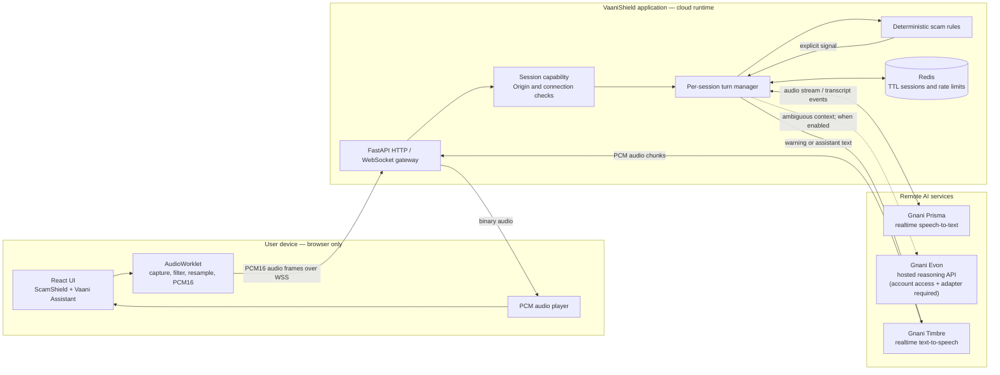
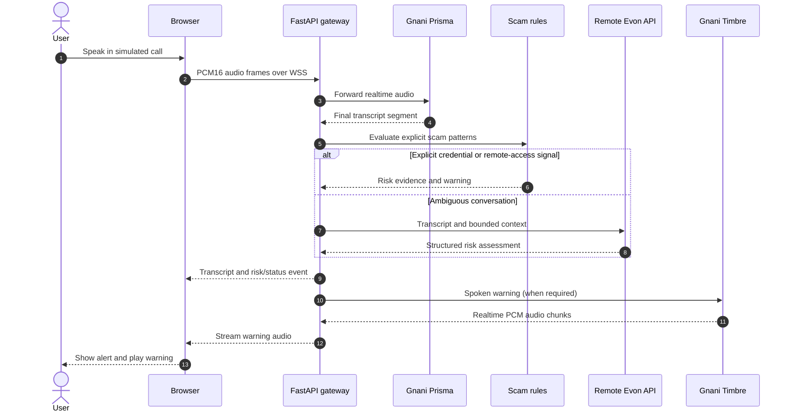
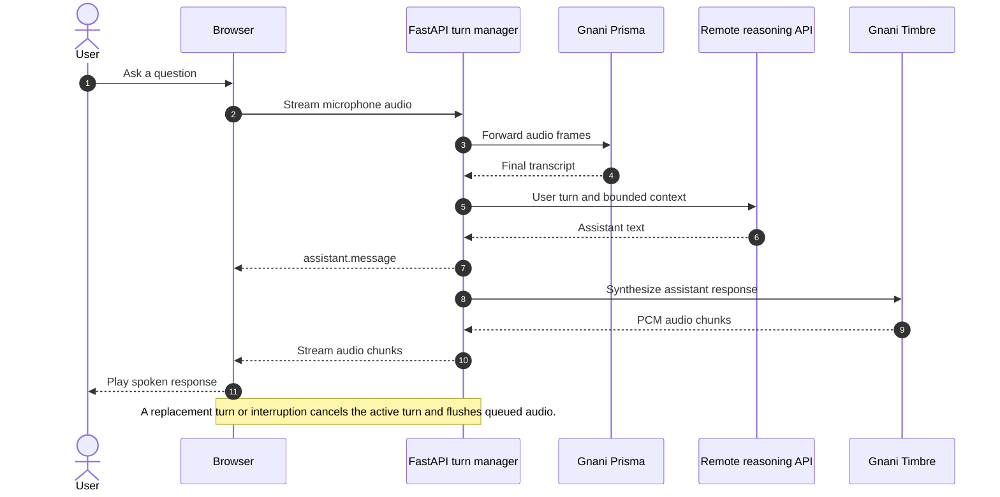

# VaaniShield

**Real-time AI voice scam detection for safer conversations.**

VaaniShield is a browser-based, Hinglish-first voice safety application. It combines speech recognition, deterministic scam-pattern detection, contextual reasoning, and spoken responses to help users recognize suspicious requests during a conversation.

> **Product boundary:** ScamShield currently provides a simulated incoming-call experience in the browser. It does not intercept cellular calls, monitor a phone dialer, or provide operating-system-level call screening.

## Solution pitch

Voice scams use urgency, impersonation, and social engineering to persuade people to disclose OTPs, UPI PINs, banking credentials, or other sensitive information. Traditional spam filters may not recognize these tactics once a conversation is already in progress.

**VaaniShield is an AI-powered voice safety assistant that analyses spoken conversations and surfaces timely warnings when it detects suspicious behaviour.** The browser captures microphone audio and streams it to the application backend. Gnani Prisma converts speech to text; deterministic rules immediately identify explicit credential-theft and remote-access patterns; contextual reasoning can assess less obvious turns; and Gnani Timbre can speak warnings or assistant responses back to the user.

The product has two experiences: **ScamShield**, a simulated caller flow for scam-awareness demonstrations, and **Vaani Assistant**, a separate voice conversation with an AI assistant. The system is designed for cloud inference: the user's PC runs the browser and, during development, the application services—not the AI model weights or model inference server.

**Goal:** make voice interactions safer by explaining risk signals and helping users pause before sharing sensitive information. VaaniShield is an assistive warning tool, not a guarantee that every scam will be detected.

## At a glance

| Area | Technology / approach |
|---|---|
| Frontend | React, TypeScript, Vite |
| Backend | Python 3.11+, FastAPI, WebSockets |
| Speech-to-text | Gnani Prisma realtime STT |
| Text-to-speech | Gnani Timbre realtime TTS |
| Scam detection | Deterministic rules first; optional contextual LLM analysis |
| Contextual model | Evon v3.3 is the intended Gnani reasoning model; hosted API entitlement and its exact request contract must be verified before claiming the managed integration is active |
| Session state | Redis-backed TTL sessions and rate limits in production |
| Audio transport | Mono PCM16LE over WebSockets |
| Local inference | **Not required.** Model inference is intended to happen through remote cloud APIs. |

## What is implemented

| Capability | Current implementation | What is still required |
|---|---|---|
| Realtime speech recognition | Prisma realtime WebSocket adapter | Valid Gnani API credentials, entitlement, and live account test |
| Browser audio capture | AudioWorklet capture, filtering, resampling, and PCM16 framing | HTTPS or localhost browser context and microphone permission |
| Scam pattern detection | Deterministic rules for explicit credential and remote-access requests | Broader labelled evaluation and tuning |
| Contextual scam analysis | Evon client using an OpenAI-compatible remote `/chat/completions` endpoint | Confirm the Gnani-hosted Evon endpoint and adapt the provider request/response contract if it differs |
| Spoken warnings and replies | Timbre realtime TTS adapter and PCM playback | Confirm voice availability and validate live account access |
| Session security | Short-lived HMAC capability, Origin validation, one-socket claim, and TTL | Production secrets, explicit origins, TLS, and deployment verification |
| Shared session state | Redis-backed TTL store and rate limiting | Managed Redis or private production Redis |
| Demo fallback | Synthetic text scenarios can exercise deterministic rules without model credentials | Keep demo scenarios fictional |

**Important Evon integration note:** the current backend's `EvonClient` is written for an OpenAI-compatible chat-completions endpoint configured through `EVON_BASE_URL`. That is a remote endpoint; it does not require a model to run on the developer's PC. However, this adapter must not be described as the Gnani-managed Evon API integration until the endpoint, authentication method, payload, and response schema supplied for the user's Gnani account have been verified. Do not point it at a local model server. If Gnani's managed API uses a different contract, implement a dedicated provider adapter before enabling Evon.

## Architecture

### 1. Cloud system architecture

The browser handles microphone capture and audio playback. Application orchestration runs in the backend. Speech and reasoning inference are performed by remote provider services; no model process or model weights are required on the user's PC.



**Inference boundary:** local development may run Vite and FastAPI on localhost, but that does not mean an AI model is hosted locally. Configure provider endpoints and credentials on the backend. Do not download model weights or expose provider keys in frontend variables.

### 2. ScamShield detection sequence

ScamShield runs deterministic checks before optional contextual reasoning. An explicit high-risk signal can trigger a warning without waiting for the LLM. Ambiguous turns can use the configured remote reasoning provider; if that provider is unavailable, deterministic protection remains active.



### 3. Vaani Assistant voice sequence

Vaani Assistant is a separate session from the simulated scam flow. It uses the same speech transport but keeps its own transcript context and cancellation state.



## Runtime behaviour

1. The user starts a session and grants microphone permission.
2. The browser AudioWorklet captures mono audio, filters/resamples it, and emits PCM16LE frames.
3. The frontend opens an authenticated WebSocket to FastAPI and streams bounded binary frames.
4. FastAPI forwards audio to Prisma and receives transcript events.
5. ScamShield evaluates deterministic rules immediately. Only ambiguous turns need contextual model analysis.
6. Vaani Assistant sends completed turns to the configured remote reasoning provider.
7. Warnings and assistant responses are sent to Timbre; returned PCM chunks are streamed to the browser.
8. On interruption, turn replacement, disconnect, or expiry, active tasks and audio streams are cancelled.

## Repository layout

```text
.
├── backend/
│   ├── app/
│   │   ├── gnani/          # Prisma STT and Timbre TTS adapters
│   │   ├── risk/           # Deterministic rules and Evon client
│   │   ├── sessions/       # Session store, tokens, and rate limits
│   │   ├── config.py       # Environment-backed settings
│   │   ├── main.py         # HTTP API, WebSocket gateway, orchestration
│   │   └── schemas.py      # Request and response schemas
│   ├── evaluation/         # Smoke evaluation tools and synthetic datasets
│   ├── tests/
│   └── .env.example
├── frontend/
│   ├── public/audio/       # AudioWorklet processor
│   └── src/
│       ├── audio/          # Capture and PCM playback
│       ├── api.ts
│       └── App.tsx
├── docs/
│   ├── ARCHITECTURE.md
│   ├── GNANI_INTEGRATION.md
│   ├── PROTOCOL.md
│   └── SECURITY.md
├── docker-compose.yml
└── README.md
```

## Getting started

### Requirements

- Python 3.11 or newer
- Node.js 20 or newer
- npm
- A modern browser with AudioWorklet support
- A Gnani API account with access to the required speech services
- HTTPS in deployed environments; localhost is sufficient for local microphone development

You can run the frontend and backend locally for development while all speech/model inference remains remote. Redis is recommended for production and is included in the Docker Compose setup.

### 1. Configure the backend

From the repository root:

```bash
cd backend
python -m venv .venv

# Windows PowerShell
.venv\Scripts\Activate.ps1

# macOS / Linux
# source .venv/bin/activate

pip install -e ".[dev]"
```

Copy the example environment file:

```bash
# Windows PowerShell
Copy-Item .env.example .env

# macOS / Linux
# cp .env.example .env
```

Add your Gnani API key to `backend/.env`:

```dotenv
GNANI_API_KEY=your_gnani_api_key
```

Keep this file private. Never commit it or place provider credentials in a `VITE_*` frontend variable.

### 2. Configure contextual reasoning

The current Evon adapter expects an OpenAI-compatible remote chat-completions API. Configure it only with a remote HTTPS endpoint for which you have authorization:

```dotenv
EVON_BASE_URL=https://your-authorized-remote-endpoint/v1
EVON_MODEL=your-provider-model-id
EVON_API_KEY=your-provider-api-key
EVON_TIMEOUT_SECONDS=20
```

These values are examples, not Gnani endpoint details. Use the exact endpoint, model identifier, authentication scheme, and request contract supplied in your Gnani account documentation. If Gnani's managed Evon endpoint is not OpenAI-compatible, the backend needs a dedicated Gnani Evon adapter; setting the URL alone will not make incompatible APIs work.

If Evon is not configured, the deterministic ScamShield rules remain available, but contextual scam analysis and the full Vaani Assistant reasoning flow will not be enabled.

### 3. Start the backend

```bash
uvicorn app.main:app --reload --port 8000
```

The API is available at `http://localhost:8000`. Useful endpoints:

- `GET /health` — process health
- `GET /ready` — readiness and provider configuration status
- `GET /api/config` — frontend-safe model/configuration metadata

### 4. Start the frontend

In a second terminal:

```bash
cd frontend
npm install
```

Create the frontend environment file:

```dotenv
VITE_API_BASE=http://localhost:8000
```

Start Vite:

```bash
npm run dev
```

Open `http://localhost:5173` and grant microphone access when starting a session.

## Environment configuration

| Variable | Purpose | Notes |
|---|---|---|
| `GNANI_API_KEY` | Authenticates Prisma and Timbre requests | Secret; backend only |
| `PRISMA_MODEL` | Prisma model label | Defaults to `prisma-v2.5` |
| `PRISMA_WS_URL` | Realtime STT WebSocket endpoint | Defaults to the current configured Gnani endpoint |
| `PRISMA_LANGUAGE_CODE` | STT language | `hi-IN` or `en-IN` in current settings |
| `TIMBRE_MODEL` | TTS model label | Defaults to `timbre-v2.5` |
| `TIMBRE_WS_URL` | Realtime TTS WebSocket endpoint | Defaults to the current configured Gnani endpoint |
| `TIMBRE_VOICE` | TTS voice | Confirm availability in your Gnani account |
| `TIMBRE_LANGUAGE` | TTS language mode | Defaults to `hi-en` |
| `EVON_BASE_URL` | Remote OpenAI-compatible reasoning endpoint | Must not point to a model running on the user's PC |
| `EVON_MODEL` | Model identifier expected by that endpoint | Use the provider-issued identifier |
| `EVON_API_KEY` | Optional reasoning-provider credential | Secret; backend only |
| `ENVIRONMENT` | Runtime environment | `development`, `test`, or `production` |
| `CORS_ORIGINS` | Allowed browser origins | Explicit origins in production |
| `SESSION_SIGNING_SECRET` | Signs session capabilities | Use a unique random value of at least 32 characters in production |
| `SESSION_TTL_SECONDS` | Session capability lifetime | Maximum 840 seconds in current settings |
| `REDIS_URL` | Shared session store and rate limiter | Required in production |

The complete set of variables and defaults is maintained in [backend/.env.example](backend/.env.example).

## Run tests and checks

Backend:

```bash
cd backend
pytest -q
ruff check app tests evaluation
python -m evaluation.evaluate_rules --dataset evaluation/datasets/rules_smoke.jsonl
python -m evaluation.evaluate_transcripts --dataset evaluation/datasets/transcripts_smoke.jsonl
python -m evaluation.evaluate_latency --dataset evaluation/datasets/latency_smoke.jsonl
```

Frontend:

```bash
cd frontend
npm install
npm run build
```

The checked-in evaluation datasets are synthetic smoke examples, not production model benchmarks. Evaluate with a labelled, held-out dataset before making accuracy or latency claims. CI runs backend lint/tests, smoke evaluations, and the frontend production build.

## Docker Compose

The repository includes a Compose setup for the API, frontend, and Redis:

```bash
# From the repository root, after configuring backend/.env
docker compose up --build
```

The frontend is exposed on port 8080 by default. Configure `CORS_ORIGINS` to match the browser-facing origin. Use TLS through a trusted reverse proxy for deployment. Docker Compose runs the application services and Redis; it does not download or run AI model weights.

## Security, privacy, and safety

- Provider API keys stay on the backend and must never be exposed through frontend build variables or API responses.
- WebSocket sessions use short-lived HMAC capabilities, Origin checks, and a single active connection claim.
- Production should use Redis, explicit CORS origins, a strong unique signing secret, and HTTPS/WSS.
- Raw audio and transcripts are not persisted by default.
- Do not log raw audio, provider credentials, authorization headers, or sensitive financial information.
- Use fictional examples in demonstrations. Never ask for or store real OTPs, UPI PINs, CVVs, passwords, or full account details.
- Clearly disclose that users are interacting with an AI assistant.
- VaaniShield is not a certified financial security product and does not currently intercept real phone calls.
- Do not describe the application as providing noise cancellation; audio preprocessing is not equivalent to denoising.

## Known limitations and release checklist

Before describing the system as production-ready:

- [ ] Verify the active Gnani account's Prisma and Timbre entitlements, quotas, and selected voice.
- [ ] Obtain and verify Evon hosted API access, endpoint, authentication, payload, and response schema.
- [ ] Implement or validate the Evon provider adapter against the actual account API; do not assume OpenAI compatibility.
- [ ] Run live end-to-end tests for microphone capture, STT, contextual analysis, TTS, interruption, and reconnect behaviour.
- [ ] Measure end-to-end latency, transcript WER/CER, scam precision/recall, and false-positive/false-negative rates on a held-out dataset.
- [ ] Perform security and load testing; configure TLS, Redis, CORS, rate limits, secrets, and monitoring.
- [ ] Validate the user-facing disclosure and warning language for each supported language.

A configured key or endpoint is not proof that a provider is reachable, entitled, healthy, or accurate.

## Official references

- [Gnani API quick start](https://docs.gnani.ai/api/introduction/quick-start)
- [Prisma realtime STT](https://docs.gnani.ai/api/STT/stt-websocket)
- [Timbre realtime TTS](https://docs.gnani.ai/api/TTS/tts-websocket)
- [Evon v3.3 hosted API waitlist and beta information](https://www.gnani.ai/evon-waitlist)
- [Evon v3.3 open-weight model card](https://huggingface.co/gnani/gnani-evon-v3.3-30B-A3B)

---

**Repository:** https://github.com/Bhaumik-99/gnani.ai-task
