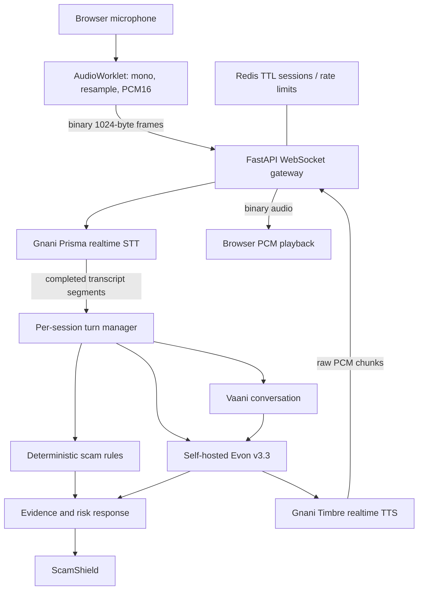

# VaaniShield

**Your voice. Your protection.**

VaaniShield is a browser-based Hinglish voice-security application with two experiences:

- **ScamShield:** a simulated caller experience. It streams microphone audio to Gnani Prisma, runs immediate deterministic rules, and optionally sends ambiguous context to a self-hosted Evon v3.3 model for classification.
- **Vaani Assistant:** a separate voice conversation using Prisma speech recognition, self-hosted Evon reasoning, and Gnani Timbre speech synthesis.

This is **not** an incoming telephone-call interception or mobile call-screening service. The call screen is a clearly labelled simulation.

## Current model availability

The current Gnani internship/API materials list **Prisma v2.5** and **Timbre v2.5** on the API platform. **Evon v3.3** is open-weight and must be requested and self-hosted; it is not currently exposed as a hosted API-platform inference model. This repository defaults to the documented v2.5 speech models and v3 realtime STT transport. Confirm model entitlements and voice availability in your Gnani console before deployment.

## What is implemented

| Capability | Implementation | Requirement |
|---|---|---|
| Realtime STT | Prisma realtime WebSocket | Gnani API key |
| Audio input | AudioWorklet, mono PCM16LE, anti-alias filter and resampling | Secure browser context |
| Binary transport | 1,024-byte frames over browser WebSocket and upstream Prisma socket | Backend |
| Immediate scam rules | Credential requests and remote-access manipulation | Backend |
| Contextual scam reasoning | Evon v3.3 through self-hosted OpenAI-compatible vLLM endpoint | Evon weights and GPU host |
| Realtime speech output | Timbre v2.5 WebSocket, raw PCM chunk playback | Gnani API key |
| Conversation interruption | Current turn cancellation and playback flush | Backend/frontend |
| Session security | HMAC capability token, Origin check, one-socket claim, TTL | Backend |
| Shared state and rate limits | Redis-backed TTL sessions and rate limiting | Redis in production |
| Demo fallback | Fictional text scenario tests deterministic rules without model credentials | Backend |

“Configured” in the UI means credentials and endpoint settings are present. It is not proof of a live provider health check. Live credential and latency validation remains a deployment step.

## Architecture



The experiences share transport and provider adapters, but session state, context and cancellation are isolated per session. Audio is not written to disk or persisted by default.

## Quick start

Requirements: Python 3.11+, Node.js 20+, and a browser that supports AudioWorklet. Microphone access requires HTTPS or localhost.

### Backend

```bash
cd backend
python -m venv .venv
# Windows PowerShell: .venv\\Scripts\\Activate.ps1
# macOS/Linux: source .venv/bin/activate
pip install -e ".[dev]"
cp .env.example .env
uvicorn app.main:app --reload --port 8000
```

Set `GNANI_API_KEY` in `backend/.env` to enable live Prisma/Timbre. Never put this key in a `VITE_*` variable or commit `.env`.

### Frontend

```bash
cd frontend
cp .env.example .env
npm install
npm run dev
```

The UI runs at `http://localhost:5173`. The example API base points to `http://localhost:8000`.

### Enable Evon v3.3

Evon v3.3 is open-weight and requires separate access to the model weights. Serve the approved weights behind a compatible vLLM OpenAI API endpoint. Configure:

- `EVON_BASE_URL`: endpoint root ending in `/v1` (for example, a private `https://...` URL).
- `EVON_MODEL`: the model name registered by the serving host.
- `EVON_API_KEY`: optional bearer token if the gateway requires it.

The backend calls `/chat/completions`, keeps transcripts in untrusted user content, and validates the returned JSON before using a model classification. Do not expose the self-hosted endpoint or model credentials in browser code.

## Run checks

```bash
cd backend
pytest -q
ruff check app tests

cd ../frontend
npm install
npm run build
```

CI runs backend tests/lint and the frontend production build. Provider tests should be mocked in CI; perform live smoke tests separately with authorized credentials.

## Privacy and demo safety

- Microphone permission is requested only after the user starts a session and Prisma is configured.
- Audio is streamed for inference; raw audio and transcripts are not persisted by default.
- Provider credentials remain on the backend.
- Use fictional scam phrases only. Never collect or retain real OTPs, UPI PINs, CVVs, passwords or full account details.
- The app is not a certified financial security product and does not intercept real mobile calls.
- Do not claim noise cancellation. ASR performance on noisy audio is not evidence of denoising.

## Official integration references

- [Gnani API quick start](https://docs.gnani.ai/api/introduction/quick-start)
- [Prisma realtime STT](https://docs.gnani.ai/api/STT/stt-websocket)
- [Timbre realtime TTS](https://docs.gnani.ai/api/TTS/tts-websocket)
- [Gnani internship models and Evon access FAQ](https://www.gnani.ai/internship)

## Remaining release gates

The code is an integration implementation, not proof of production readiness. Before calling it production-ready, validate the supplied API key and plan against Prisma/Timbre, confirm the selected Timbre voice in the account catalog, run Evon weights on a provisioned vLLM host, and run end-to-end microphone, browser, load, security and held-out evaluation tests. Record measured WER/CER, scam precision/recall, false-positive/negative rates, frame loss and end-to-end latency rather than inventing benchmark results.
