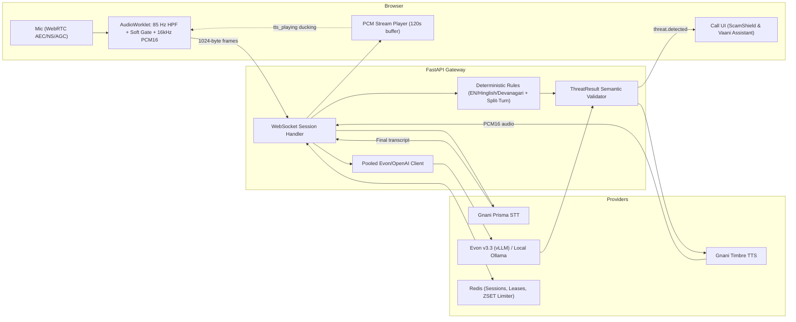

# VaaniShield architecture

## Product boundaries

- ScamShield is a browser-based simulated call. It does not intercept real phone or telecom calls.
- Vaani Assistant is a separate voice-conversation session.
- Both share transport and provider adapters but have isolated session state, transcript context and turn cancellation.
- Raw audio and transcript persistence are disabled by default.

## Runtime

1. The user starts a session and grants microphone permission.
2. Browser WebRTC processing plus the AudioWorklet applies an 85 Hz high-pass filter, adaptive soft noise gate (with TTS playback ducking), and anti-alias low-pass resampling to produce mono PCM16LE frames.
3. The browser sends exactly 1,024-byte binary frames to FastAPI over an Origin-validated, capability-authenticated WebSocket.
4. FastAPI forwards frames to Prisma realtime STT and consumes completed transcript events.
5. Both ScamShield and Vaani Assistant automatically run immediate English/Hinglish/Devanagari deterministic credential/remote-access rules (including adjacent split-turn detection). Ambiguous/suspicious turns are classified by the pooled Evon v3.3 / OpenAI-compatible client with semantic validation.
6. Vaani Assistant streams conversational replies through Timbre v2.5.
7. Timbre raw PCM chunks are sent to the browser and scheduled by the playback queue (up to 120s buffer), automatically ducking mic sensitivity while speaking. Interruption cancels the active turn and flushes queued audio.

## Components

- `frontend/src/audio/capture.ts`: microphone capture, TTS ducking coordination, bounded raw PCM player and resource lifecycle.
- `frontend/public/audio/pcm-capture-worklet.js`: mono capture, 85 Hz Butterworth HPF, adaptive noise-floor soft gate, anti-alias filtering, rate conversion and 512-sample frame emission.
- `backend/app/gnani/prisma.py`: Prisma realtime STT WebSocket.
- `backend/app/gnani/timbre.py`: Timbre realtime TTS WebSocket and PCM chunk decode.
- `backend/app/risk/rules.py`: deterministic multilingual (English/Hinglish/Devanagari) scam detection and evidence extraction.
- `backend/app/risk/evon.py`: pooled OpenAI-compatible Evon v3.3 / Ollama HTTP client.
- `backend/app/sessions`: HMAC capabilities, TTL store, expiring ownership-aware socket leases, Redis ZSET sliding-window rate limiting, and IPv6 `/64` IP normalization.
- `backend/app/main.py`: session API, WebSocket gateway, turn orchestration and cancellation.

## Model versions and contracts

- Prisma v2.5 is the currently listed API model; the realtime transport URL contains `/stt/v3/stream`. The handshake uses `x-api-key-id`, `lang_code`, `x-sample-rate`, and `x-format`.
- Timbre v2.5 is the currently listed realtime TTS model; its request selects voice, language and audio format.
- Evon v3.3 is open-weight and is served separately behind a self-hosted vLLM-compatible endpoint.
- Warp is not integrated and is not represented as a denoiser.

## Session security and reliability

- Short-lived HMAC token is bound to one session and passed in a WebSocket subprotocol, not a URL query string.
- Validate the WebSocket `Origin` header against explicit configured `CORS_ORIGINS` (missing or untrusted origins are rejected with `4403`).
- One active socket per session using expiring ownership-aware leases; capability TTL is capped at 14 minutes.
- Production configuration requires Redis, a strong signing secret and explicit CORS origins.
- Audio frame size, frame rate and control event size are bounded.
- On turn replacement, interruption, session end, expiry or disconnect, cancel provider/model tasks and release streams, audio contexts and session claims.
- Provider status is configuration/connection state, not a promise of model quality or availability.

## Security

- Provider keys remain server-side.
- No default audio/transcript persistence.
- Do not log raw audio, secrets, authorization headers or sensitive financial credentials.
- Keep Redis and the Evon endpoint on a private network.
- Keep the public API behind a reverse proxy with TLS/WSS.
